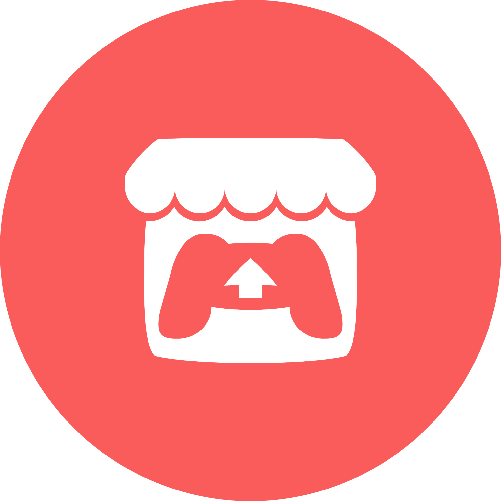

# 2D PEC2 - Plataformas 2D

---

<a style="display:flex; gap:20px; color:#fa5c5c; align-item:middle;" href="https://freyzerfault.itch.io/supermarpo1">
  
  <span style="font-size: 2rem; vertical-align: middle;">
    Jugar en itch.io
  </span>
</a>

---

<a style="display:flex; gap:20px; color:#fa5c5c; align-item:middle;" href="https://youtu.be/_b4n_sy7Xus">
  
  <span style="font-size: 2rem; vertical-align: middle;">
    Video en Youtube
  </span>
</a>

---


> Juego desarrollado en Unity  
> Para la PEC2 - Un Juego de Plataformas  
> de la asignatura de Programación de Videojuegos 2D
> del Máster en Diseño y Programación de Videojuegos  
> en la Universitat Oberta de Catalunya

## **Contenido:**
1. [Descripción](#Descripción)
2. [Gameplay](#Gameplay)
3. [Diseño](#Diseño)
4. [Controles](#Controles)
5. [Assets](#Assets)

<p align="center">
  
</p>

---

## Descripción

Es una copia del primer nivel del original Super Mario Bros de NES

Reinterpretado con una temática en un planeta con bosque, usando los árboles y nubes como plataformas.  
Tu personaje es un alien y los enemigos son la fauna local.

<p align="center">
  
</p>

---

## Gameplay

El objetivo es llegar a la bandera al final de la fase.

Como power up único tienes una estrella, escondida en algunos bloques, que te otorga vulnerabilidad durante 10 segundos.  
Te permite matar a los enemigos al tocarlos y no recibir daño (la estrella clásica de Mario).  
Adicionalmente, si recibes 1 golpe tras acabarse el efecto de la estrella no morirás.

Puedes recolectar monedas (100 puntos), y 4 diamantes escondidos (2000 puntos).

Los enemigos se pueden matar al saltar sobre ellos como en los juegos de Mario.  
Durante la invulnerabilidad de la estrella morirán al tocarlos sin más.

Morirás si caes del mapa.

❕ Ciertos abismos no son del todo mortales.

<p align="center">
  
</p>

---

## Diseño

### Game Manager

Tiene la responsabilidad de gestionar el estado del juego. Si está en pausa, 
ha llegado al final del juego, en el Main Menu...  

Y otros sistemas, como el Menú de Pausa se suscriben a sus cambios de estado para abrir o cerrarse  
cuando entre o salga del Estado 'Paused'.

<p align="center">
  
</p>

### Data Manager

Se encarga de guardar datos y avisar de cambios en estos.

Los datos se guardan en **GameDataSO** (un ScriptableObject).

Cuando alguien registra que se ha cogido una moneda (en este caso es el **CollectableObject** 
al colisionar con el jugador), aumenta el contador de monedas dentro de **CollectableData**  
asociado al tipo 'Coin'.  
Cada vez que ocurre avisa a los suscriptores del evento '**OnCollectableAdded**'.

Por ejemplo, el ScoreUI actualiza su contador de monedas y la puntuación.

La puntuación aumenta según el tipo de objeto o enemigo que has matado. Los puntos asociados por estos
se pueden modificar en el atributo 'Score' del '**EntityData**', del que heredan '**CollectableData**'
y '**EnemyData**'.

Estos datos se guardan en un SerializedDictionary<string, EntityData> ([Asset de la Unity Store](https://assetstore.unity.com/packages/tools/utilities/serialized-dictionary-243052))

<p align="center">
  
</p>

### Audio Manager

Entre otras utilidades, recicladas de mis proyectos anteriores,
he añadido el objeto AudioDataSO (Scriptable Object), que almacena datos de audio globales.  
Lo que nos interesa aquí es registrar en un diccionario los clips de audio que se reproducen al inicio de cada Escena.

También se encarga de reproducir música y sonidos de forma global y gestionar su volumen.

Por ejemplo, desde el PlayerEffects, al ejecutarse el evento OnDeath del PlayerController:

```csharp
AudioManager.Instance.PlayMusic(deathClip);
```

Y AudioManager parará el AudioSource principal de música (_playingMusic) y añade un AudioSource con
el nuevo deathClip y lo ejecuta.

<p align="center">
  
</p>

### HUD

Cada elemento del HUD se gestiona con un script distinto (ScoreUI, TimeUI, PauseMenu, DeathMenu...)

Están completamente **desacoplados** de la lógica con el patrón **Observer**.

Simplemente, escuchan los eventos del **PlayerController**, como **OnDeath** para abrir el menú de muerte,
u **OnCollectableAdded** del **DataManager** para actualizar el contador de monedas o diamantes.

<p align="center">
  
</p>

### PLAYER

El Player se divide en PlayerController y PlayerEffects.

#### Player Controller

Gestiona los inputs del **PlayerInput** y los usa para calcular el movimiento, ejecutar un salto,
bajar de una plataforma, etc.

Se ejecutan distintos eventos cuando salta, aterriza, muere, es golpeado o rebota en un enemigo.  
Y es el PlayerEffects el que escucha estos eventos para reproducir sonidos o partículas.

#### Detección del Suelo

Se encarga de detectar si está sobre suelo, qué tipo de suelo según la Layer del objeto...  
IsOnWalkable, por ejemplo, comprueba que esté sobre un objeto cuya Layer encaje con la LayerMask
que contiene las layers "Ground", "Platform" y "Moving Environment".

Para detectar el suelo utiliza una pequeña caja bajo los pies separada de la lógica de los colliders.

#### Salto con Buffering

Se utiliza **Buffering** para el **Salto**, utilizando un timer que se reinicia cada vez que se
pulsa el botón de salto conservando el input del salto en un "buffer".  
Al tocar el suelo mientras el buffer está activo, se produce el salto aunque se haya soltado
el botón justo antes de tocar el suelo.  
Cuando el tiempo del buffer pasa o se ha tocado el suelo, se reinicia.

#### Player Effects

Ejecuta los sonidos y sistemas de partículas de forma independiente.

Además, se encarga de desacoplar los sistemas de partículas cuando el jugador se separa del suelo,
para que no le sigan en el aire, quedándose SIEMPRE anclados en el suelo, pero usando al jugador
como origen cuando este está sobre el suelo.

<p align="center">
  
</p>

### MAPA

Se compone de distintos Tilemaps en una Grid Rectangular.

Cada tilemap tiene características distintas y layer distintas para hacer más fácil el trabajo.

Los tilemaps que usan Colliders utilizan el CompositeCollider para optimizar el rendimiento,
y reducir la complejidad.

Las plataformas usan, además del CompositeCollider, el PlatformEffector, que permite discriminar las
colisiones que provienen de arriba o de abajo, permitiendo atravesarlas en una sola dirección.

<p align="center">
  
</p>

#### Bloques

Tienen 2 Layer de Animación.

La 1º discrimina si son **rompibles** o no. Si lo son se eliminan al finalizar la animación de ruptura.  
La 2º discrimina **el objeto que contienen**, ya sea una **moneda** o un **Power Up**.

Si contienen una moneda, simplemente ejecutan la animación y registran su obtención en el DataManager.  
Y si es un Power Up, se ejecuta la animación y se sustituye el objeto visual que sale por el prefab
del Power Up.

Se añade un **Edge Collider** debajo para detectar si son golpeados desde debajo únicamente.

<p align="center">
  
</p>


#### Coleccionables

Cuando el jugador colisiona con ellos, se llama al **DataManager** para registrar un **incremento** del
tipo de coleccionable que sea.

Hay una **variante con físicas** para la mecánica del cañón de monedas en el *Bonus Level*.

<p align="center">
  
</p>

#### Power Ups

He implementado la estrella de los Mario originales.

Da al jugador 10 segundos de invencibilidad cuando la recoge.

Rebota cuando toca algún elemento que pueda ser suelo (plataformas y bloques incluidos).

<p align="center">
  
</p>

#### Platformas movibles

He usado [DOTween](https://dotween.demigiant.com/index.php) para reproducir la animación, yendo desde el punto inicial y el final, representados con Gizmos.

Se puede activar y desactivar y cambia su Sprite.

Para simplificar las físicas con el jugador he implementado la técnica de **Parenting**.

<p align="center">
  
</p>

#### Botones de Presión

Detecta cuando el jugador se coloca encima y ejecuta sus eventos correspondientes, a los que, por ejemplo,
una plataforma movible se puede suscribir. De este modo, se puede implementar cualquier lógica en otros objetos
activables a través de un botón.

<p align="center">
  
</p>

#### Enemigos

Los enemigos heredan de ***JumpableEnemy***, que implementa la funcionalidad de discriminar colisiones con el jugador
según el **ángulo** de esta. Si está **dentro del ángulo** (90º) el **enemigo muere** y produce un **Rebote** en el jugador.  
Este **Rebote** ejecuta un salto con una fuerza menor, pero si el jugador registra un salto a la vez, la altura será
la misma que un salto normal.

Si toca al jugador **fuera del ángulo** y **NO es invencible** (por la estrella), el jugador recibe **daño** y es **empujado**.  
Si el jugador **NO es invulnerable** (tiene un tiempo de invulnerabilidad tras acabarse el efecto de la invencibilidad)
**morirá**.

<p align="center">
  
</p>

### Bandera de Meta

He implementado la misma mecánica de la bandera que Mario.

Utiliza **DOTween** para la secuencia animada, ya que me facilita el trabajo más que con el AnimatorController.

Cuando toca la bandera desactiva todos los inputs.  
Hace un movimiento vertical suave y después pone a andar indefinidamente al personaje.

He colocado un trigger más adelante para que cuando lo toque se pase a la siguiente escena (Bonus Level).


### Bonus Level

He implementado los clásicos niveles de créditos de Mario en los que te permiten jugar una fase extra
donde te escupen monedas sin parar y mientras van pasando los créditos.

El CoinSpawner elige un cañón de forma aleatoria con una frecuencia de tiempo aleatoria.  
Dispara las monedas en una fuerza aleatoria y una dirección aleatoria dentro del rango del ángulo dado, formando un arco que dibujo
con Gizmos.  
Las monedas son variantes de la misma moneda, pero con físicas.

<p align="center">
  
  
</p>

---

## Controles

| <br>                   | Teclado                 | Mando (XBOX)             |
|------------------------|-------------------------|--------------------------|
| Moverte                | A-S / ← →               | 🕹️Izq / Cruceta ← →     |
| Saltar                 | W / ↑ / Espacio         | A / Cruceta ↑<br>        |
| Caer de una Plataforma | S / ↓                   | 🕹️Izq ↓ / Cruceta ↓<br> |
| Correr                 | Mantén Shift / Ctrl<br> | X / B<br>                |
| Pausar Juego           | Escape / Intro<br>      | Start<br>                |

---

## Assets

### Sprites

- **KENNEY** - LICENSE [Creative Commons CC0](https://creativecommons.org/publicdomain/zero/1.0/)

  > [Pixel Platformer](https://kenney.nl/assets/pixel-platformer) Personajes, Escenario y Fondo
  >
  > <p align="center">
  >   
  >   
  >   
  > </p>

  > [Game Icons](https://kenney.nl/assets/game-icons)
  >
  > <p align="center">
  >   
  > </p>

### UI

- **KENNEY** - LICENSE [Creative Commons CC0](https://creativecommons.org/publicdomain/zero/1.0/)
  > [UI Pack - Pixel Adventure](https://kenney.nl/assets/ui-pack-pixel-adventure)
  >
  > <p align="center">
  >   
  > </p>

### Audio

#### Music

- **[Incompetech - Royalty Free Music](https://incompetech.com/music/royalty-free/music.html)**

  > "Doobly Doo" Kevin MacLeod (incompetech.com)
  > Licensed under Creative Commons: By Attribution 4.0 License
  > http://creativecommons.org/licenses/by/4.0/

  > "Newer Wave" Kevin MacLeod (incompetech.com)
  > Licensed under Creative Commons: By Attribution 4.0 License
  > http://creativecommons.org/licenses/by/4.0/

  > "Nowhere Land" Kevin MacLeod (incompetech.com)
  > Licensed under Creative Commons: By Attribution 4.0 License
  > http://creativecommons.org/licenses/by/4.0/

  > "Blip Stream" Kevin MacLeod (incompetech.com)
  > Licensed under Creative Commons: By Attribution 4.0 License
  > http://creativecommons.org/licenses/by/4.0/

  > "Super Friendly" Kevin MacLeod (incompetech.com)
  > Licensed under Creative Commons: By Attribution 4.0 License
  > http://creativecommons.org/licenses/by/4.0/

  > "Cipher" Kevin MacLeod (incompetech.com)
  > Licensed under Creative Commons: By Attribution 4.0 License
  > http://creativecommons.org/licenses/by/4.0/

  > "Ambler" Kevin MacLeod (incompetech.com)
  > Licensed under Creative Commons: By Attribution 4.0 License
  > http://creativecommons.org/licenses/by/4.0/

---

#### SFX

> [KENNEY Interface Sounds](https://kenney.nl/assets/interface-sounds) - LICENSE [Creative Commons CC0](https://creativecommons.org/publicdomain/zero/1.0/)

---

### Fonts

- [Kenney Fonts](https://kenney.nl/assets/kenney-fonts)

---

### Otros Assets

- [SerializedDictionary](https://assetstore.unity.com/packages/tools/utilities/serialized-dictionary-243052)
- [DOTween](https://dotween.demigiant.com/index.php)

## Herramientas usadas

- **Unity 2022.3.47f1**
- **Rider 2023.3.2**
- **Github Desktop**
- **Photoshop**

---
